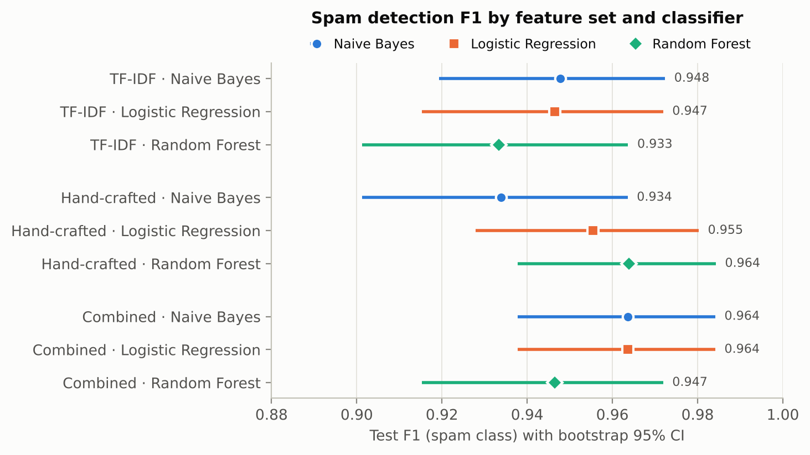
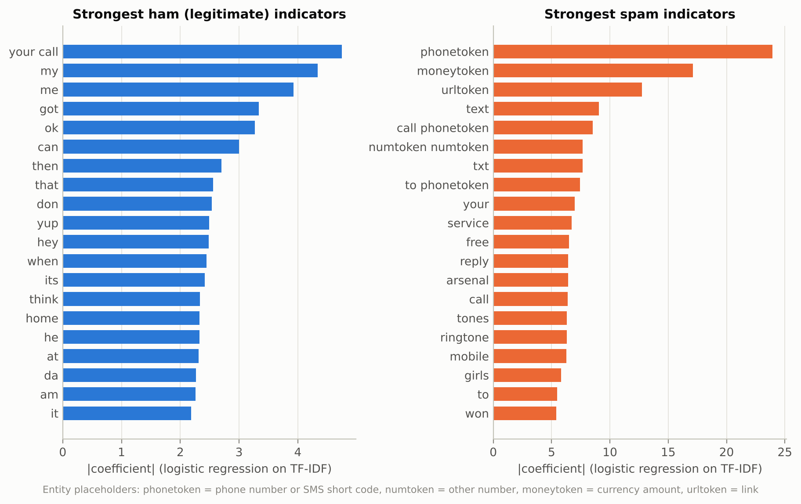

# NLP Detection of Spam and Phishing Messages

A small, fully reproducible research project. It classifies short text messages
(SMS) as **spam/phishing** or **legitimate (ham)**. It compares two kinds of
features, **TF-IDF** n-grams and **hand-crafted phishing cues** (links, phone
numbers, urgency words, capitalisation, ...), plus their combination, each
used with three classifiers: **Multinomial Naive Bayes**, **Logistic Regression**
and **Random Forest**.

The write-up is in [`paper/paper.md`](paper/paper.md). Every number and figure
in it is produced by `python run_pipeline.py`.

## Key results

Test set: 1,032 held-out unique messages (128 spam). All numbers come from `results/metrics.csv`.

| Features | Model | Precision | Recall | F1 [95% CI] | ROC-AUC | False positives | Missed spam |
|---|---|---|---|---|---|---|---|
| TF-IDF | Naive Bayes | 0.975 | 0.922 | 0.948 [0.919, 0.972] | 0.991 | 3 | 10 |
| TF-IDF | Logistic Regression | 1.000 | 0.898 | 0.947 [0.915, 0.972] | 0.999 | 0 | 13 |
| TF-IDF | Random Forest | 1.000 | 0.875 | 0.933 [0.901, 0.964] | 0.999 | 0 | 16 |
| Hand-crafted | Naive Bayes | 0.991 | 0.883 | 0.934 [0.901, 0.964] | 0.991 | 1 | 15 |
| Hand-crafted | Logistic Regression | 0.992 | 0.922 | 0.955 [0.928, 0.980] | 0.996 | 1 | 10 |
| Hand-crafted | Random Forest | 0.992 | 0.938 | 0.964 [0.938, 0.984] | 0.996 | 1 | 8 |
| **Combined** | **Naive Bayes** ⭐ | **1.000** | **0.930** | **0.964 [0.938, 0.984]** | **0.995** | **0** | **9** |
| Combined | Logistic Regression | 1.000 | 0.930 | 0.964 [0.938, 0.984] | 0.999 | 0 | 9 |
| Combined | Random Forest | 1.000 | 0.898 | 0.947 [0.915, 0.972] | 1.000 | 0 | 13 |

⭐ = chosen by **cross-validated F1 on the training split** (0.953 ± 0.011), not by test score.

* **The 17 hand-crafted cues rival roughly 10k TF-IDF n-grams** (test F1 0.934–0.964 vs 0.933–0.948). Combining both gives the best average (0.958).
* **The classifier choice barely matters.** All 95% CIs overlap, and no difference from the selected system survives a Bonferroni-corrected exact McNemar test (smallest p = 0.039 over 8 comparisons).
* **Phone numbers / short codes are the dominant cue.** One appears in 75.9% of spam and 0.1% of ham, and shuffling `n_phone_numbers` costs the Random Forest 0.24 F1. Next come links, money amounts and digit ratio.
* **Keeping stop words is correct for spam.** Removing them cuts the vocabulary by 43% and lowers CV F1 for both NB and LR. Entity normalisation raises CV F1 by about 0.011.
* **Modern smishing exposes the limits.** On 12 author-written modern lures the best systems catch 9. All of them miss the cue-free "Hi Mum, new number" scam, and most miss an OTP-theft message.

<p align="center"> </p>

## Reproducibility

`python run_pipeline.py` was run twice from scratch. Every file in `results/`, including all PNGs, was byte-identical across the two runs; only `timing.csv` (wall-clock times) differs. The library versions used are in `results/run_info.json`.


---

## Quick start

```bash
python -m venv .venv && source .venv/bin/activate   # optional
pip install -r requirements.txt
python run_pipeline.py                # full experiment, about 3.5 min on 4 CPU cores
python -m unittest discover tests     # 12 unit tests, a few seconds
```

`python run_pipeline.py --quick` is a smoke test on a 1,000-message
subsample (about 2 minutes). It writes to `results_quick/` (git-ignored) and never touches the
reported results.

Only `numpy`, `pandas`, `scikit-learn` and `matplotlib` are required. The
dataset is committed in `data/raw/`, so no network access is needed. If the
file is deleted, `src/spamdetect/data.py` downloads it again: it tries the
official UCI archive first, then a GitHub mirror, and checks the class counts.

## Repository layout

```
├── run_pipeline.py              entry point (adds src/ to the path, calls the pipeline)
├── requirements.txt
├── src/spamdetect/
│   ├── config.py                paths, seed, split/CV/bootstrap settings: the whole protocol
│   ├── data.py                  download, integrity check, de-duplication, stratified split
│   ├── preprocess.py            cleaning, entity normalisation, tokenisation
│   ├── features.py              TF-IDF, 17 hand-crafted features, combined FeatureUnion
│   ├── models.py                classifiers and hyper-parameter grids
│   ├── evaluate.py              metrics, bootstrap confidence intervals
│   ├── plots.py                 all figures (matplotlib, headless)
│   └── pipeline.py              orchestrates the experiment, writes results/
├── data/
│   ├── raw/SMSSpamCollection.tsv   SMS Spam Collection v.1 (UCI, CC BY 4.0)
│   └── probes/smishing_probes.tsv  20 author-written modern smishing/ham probes (out-of-distribution check)
├── results/                     metrics CSVs, tables, JSON summaries
│   └── figures/                 PNG figures used in the paper
├── tests/test_spamdetect.py     unit tests (stdlib unittest)
└── paper/paper.md               the research paper
```

## Dataset choice

The **SMS Spam Collection v.1** (Almeida, Gómez Hidalgo & Yamakami, 2011) is
the standard public benchmark for SMS spam. It has 5,574 English messages,
747 of them spam. It downloaded reliably (from a mirror; the UCI host was not
reachable from the build environment), so **no synthetic data is used** for
training or testing. The file is committed with its SHA-256 recorded in
`config.py`, and its class counts are checked on every load.

The corpus is mostly 2000s-era UK **spam** (premium-rate numbers, prize
draws, ringtone subscriptions). It contains few phishing messages in the
modern sense (credential theft, fake delivery or bank alerts). To see how
the models handle today's smishing, `data/probes/` holds **20 messages written
by the author**: 12 modern smishing lures and 8 modern legitimate messages,
with fictitious domains. These are a qualitative stress test, not a benchmark.
They are never used for training or model selection, and they are reported
separately.

## Design decisions

| Decision | Why |
|---|---|
| **Remove exact duplicates before splitting** (5,574 → 5,159 messages) | 415 messages (105 spam, 310 ham) are repeats: verbatim spam broadcasts and stock replies such as "Sorry, I'll call later". If one copy is in the training set and another in the test set, the test score partly measures memorisation (leakage). |
| **Stratified 80/20 hold-out + 5-fold CV on the training part** | Hyper-parameters are chosen by CV F1 on the training split only. The best overall system is also chosen by **CV F1, not test F1**, so the test set is used exactly once. |
| **Features are fitted inside the CV folds** | Each experiment is a single `Pipeline(features → classifier)`. The TF-IDF vocabulary, IDF weights and scaling ranges never see validation or test messages. |
| **Entity normalisation** (`urltoken`, `phonetoken`, `moneytoken`, `emailtoken`, `numtoken`) | `09061701461` and `www.win-82050.co.uk` are almost unique strings. What carries the signal is the *type* of entity, and a placeholder lets the model learn that type. |
| **No stop-word removal by default** | scikit-learn's English stop-word list contains *call*, *now*, *please* and *get*, which are strong spam cues. The ablation measures the effect. |
| **Hand-crafted features computed on the raw text** | Cleaning lower-cases and strips punctuation. Capitalisation (`caps_ratio`, `n_allcaps_words`) and `!` counts are only visible before cleaning. |
| **Small, literature-based cue lexicons** (urgency, reward, call-to-action, credential) | The lexicons were written from the phishing literature (persuasion cues), not mined from this dataset, so they do not leak test vocabulary. |
| **log1p + Min-Max scaling for hand-crafted features** | Counts are heavy-tailed. Values in [0, 1] are non-negative, which Multinomial NB requires, and are on the same scale as L2-normalised TF-IDF in the combined model. |
| **No class re-weighting, 0.5 threshold** | All models are compared at the same operating point on the natural ~12% spam rate. That point favours precision (few legitimate messages blocked), which is the costly error for a message filter. |
| **Bootstrap 95% CIs** (1,000 stratified resamples, same resamples for every model) | The test set has only about 128 spam messages, so a single F1 value hides a lot of uncertainty. |
| **Fixed seed (42) everywhere** | Re-running reproduces every file except `timing.csv` exactly. This was verified: see *Reproducibility* above. |

## Outputs (`results/`)

| File | Content |
|---|---|
| `metrics.csv` | one row per (feature set, model): accuracy, precision, recall, F1, ROC-AUC, PR-AUC, FPR, TN/FP/FN/TP, bootstrap CIs, CV F1 mean ± sd, chosen hyper-parameters |
| `results_table.md` | the same as a Markdown table |
| `ablation_preprocessing.csv` | raw vs. cleaned vs. cleaned + stop-words (TF-IDF with NB and LR) |
| `mcnemar_vs_selected.csv` | exact McNemar tests: selected system vs. each other configuration |
| `top_features_lr_tfidf.csv`, `top_features_nb_tfidf.csv`, `top_features_lr_combined.csv` | most predictive n-grams/features per class |
| `handcrafted_feature_importance.csv` | permutation importance (RF), Gini importance, LR coefficients |
| `handcrafted_feature_by_class.csv` | mean value and % non-zero of each cue, by class (training split) |
| `misclassified_best_model.csv` | every test error of the selected model, with its probability |
| `smishing_probe_predictions.csv`, `smishing_probe_summary.csv` | out-of-distribution probe results |
| `dataset_summary.json`, `run_info.json`, `timing.csv` | dataset statistics, protocol and library versions, run times |
| `figures/*.png` | confusion matrices, ROC and PR curves, top words, feature importance and prevalence, length distribution, model comparison |
