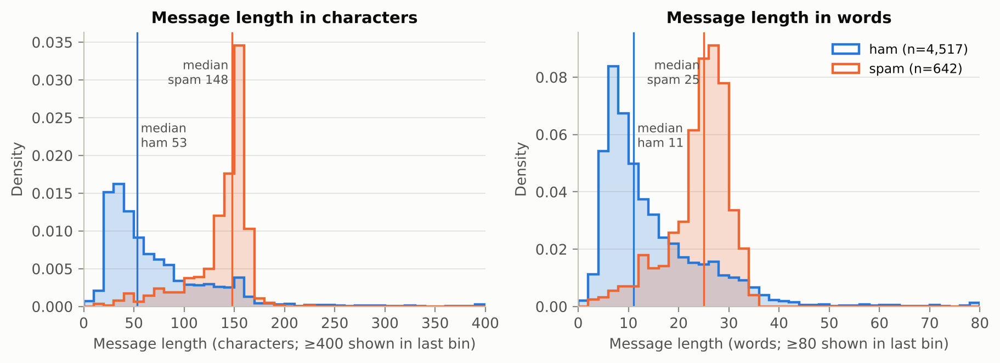
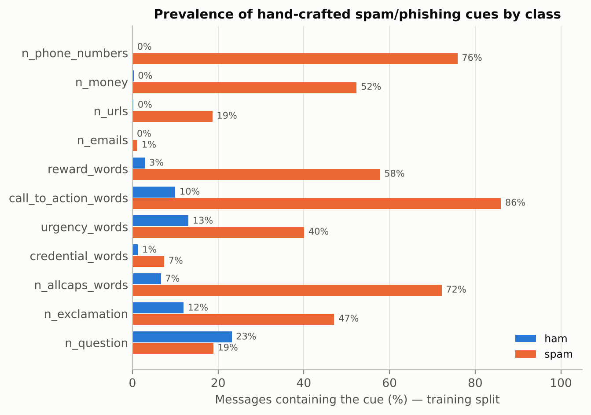
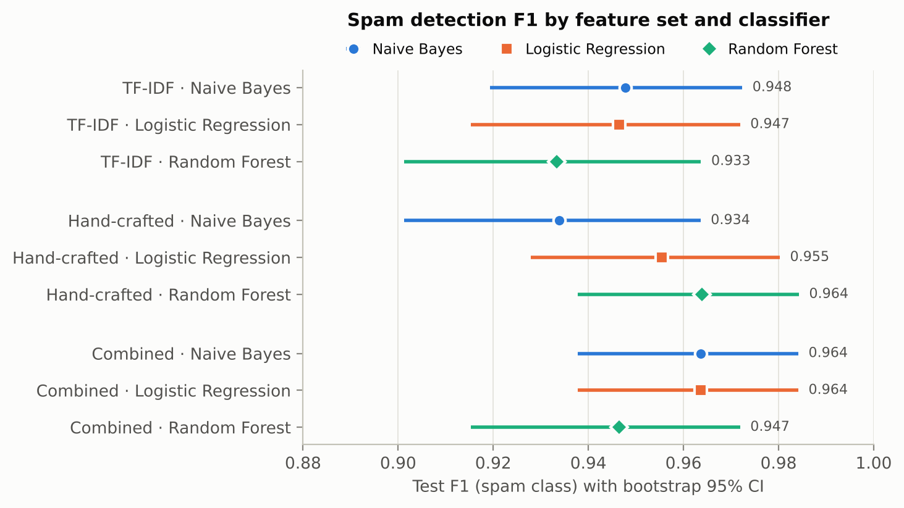
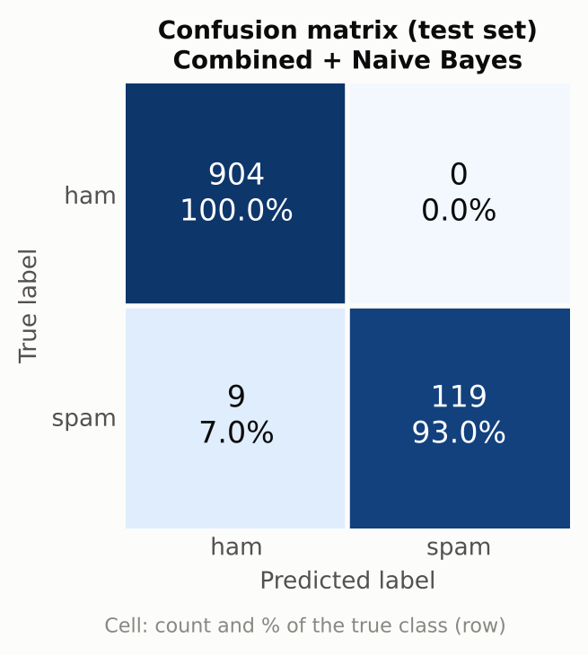
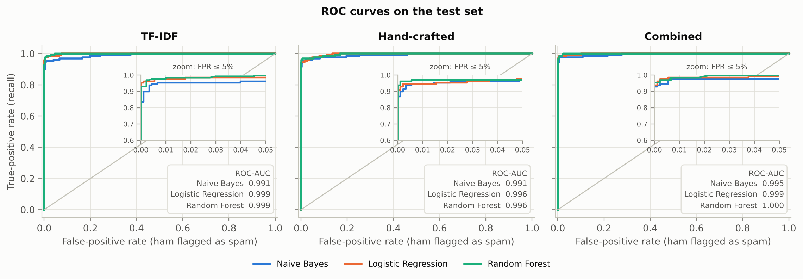
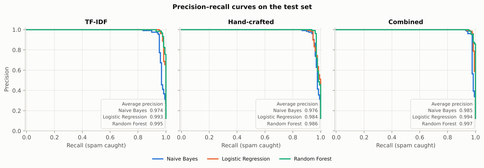
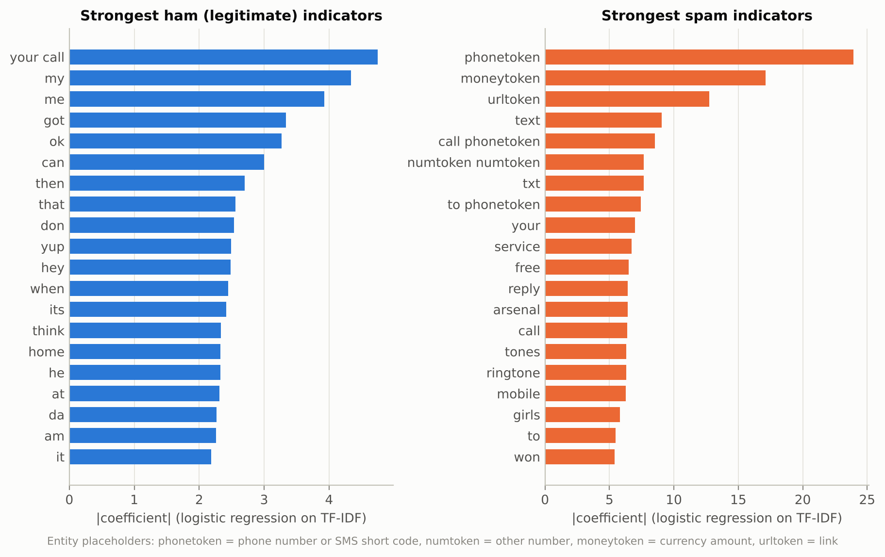
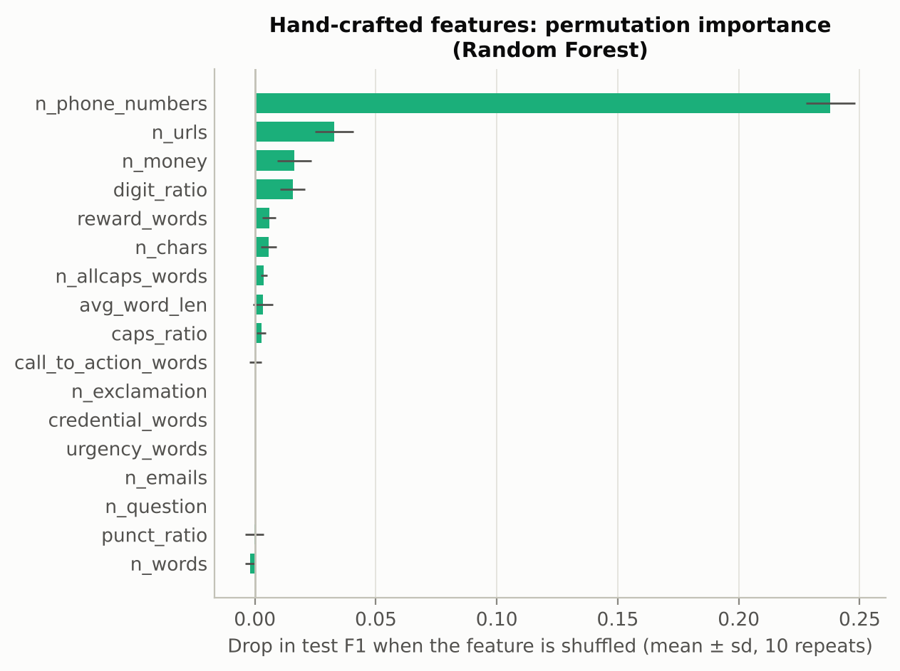

# Lexical and Hand-Crafted Cues for SMS Spam and Phishing Detection: A Reproducible Comparison of TF-IDF, Phishing-Cue Features and Their Combination

*Research mini-project. Code, data and every number in this paper are reproduced by `python run_pipeline.py`. Run on 2026-11-05 with Python 3.13.18, scikit-learn 1.9.1, NumPy 2.5.3, pandas 3.0.5 and matplotlib 3.11.2.*

---

## Abstract

Unsolicited and fraudulent text messages are a cheap attack channel. Their content is the first line of defence a filter can inspect. We compare two families of text features for classifying SMS messages as spam/phishing or legitimate ("ham"). The first is word uni- and bi-gram **TF-IDF**, computed after an entity-normalising preprocessing step that maps URLs, phone numbers, money amounts and other numbers to placeholder tokens. The second is a set of **17 hand-crafted features** motivated by the phishing literature: link and phone counts, digit and capital-letter ratios, and counts of urgency, reward, call-to-action and credential words. Each feature set, and their concatenation, is used with Multinomial Naive Bayes, Logistic Regression and a Random Forest. We use the public SMS Spam Collection. Its 415 exact duplicates are removed before an 80/20 stratified split (5,159 unique messages, 12.4% spam), and the final system is selected by cross-validated F1 on the training split alone. The selected system, **combined features with Naive Bayes**, reaches **F1 = 0.964** (bootstrap 95% CI 0.938–0.984), **precision 1.000**, recall 0.930 and ROC-AUC 0.995 on 1,032 held-out messages, with **no legitimate message misclassified**. Seventeen hand-crafted features alone reach F1 0.934–0.964, in the same range as roughly 10,000 TF-IDF dimensions (0.933–0.948). The single most important cue is the presence of a phone number or short code. On 12 author-written modern "smishing" messages (fake parcel, bank and tax alerts), the best systems catch 9 of 12. They miss lures that carry no link, number or money amount, such as the "Hi Mum, new number" scam and a one-time-password theft attempt. All differences among the top systems are within statistical noise (exact McNemar tests, bootstrap CIs). The main practical lesson is therefore not the choice of classifier. It is that 2011-era SMS spam is dominated by a few surface cues, and that phishing which avoids those cues needs other signals.

---

## 1 Introduction

Spam and phishing over SMS ("smishing") exploit a channel that users trust more than e-mail. Messages are short, links are opened on mobile devices with little URL context, and a sender can buy premium-rate numbers or register look-alike domains cheaply. A content-based filter decides from the message text alone. This makes it deployable on the device or at the carrier without access to sender reputation or URL-scanning infrastructure.

Text classification for spam is a mature problem. Naive Bayes filters were proposed for e-mail in the late 1990s (Sahami et al., 1998; Androutsopoulos et al., 2000), and discriminative models followed (Drucker et al., 1999). SMS is harder than e-mail in several ways. Messages are short (a median of 53 characters for legitimate messages in our data), heavy with abbreviations ("u", "ur", "2day"), and have no headers (Gómez Hidalgo et al., 2006; Almeida et al., 2011). Phishing research, meanwhile, has emphasised *structural* and *persuasion* cues, such as links, urgency, rewards and requests for credentials (Fette et al., 2007; Ferreira et al., 2015). These are not necessarily captured by a bag of words.

This project asks three questions:

1. **RQ1 – Representation.** How do a high-dimensional lexical representation (TF-IDF) and a compact, interpretable set of hand-crafted phishing cues compare, alone and combined?
2. **RQ2 – Classifier.** Does the choice among a generative linear model (Naive Bayes), a discriminative linear model (Logistic Regression) and a non-linear ensemble (Random Forest) matter once the representation is fixed?
3. **RQ3 – What is learned, and does it transfer?** Which cues drive the decisions, and do models trained on a classic SMS corpus recognise modern phishing lures?

Our contributions are modest but carefully controlled. We provide a leakage-aware protocol (de-duplication, features fitted inside CV folds, model selection without the test set), uncertainty estimates (bootstrap CIs, paired McNemar tests), an ablation of the preprocessing choices, and a qualitative out-of-distribution probe. Everything is released as a single reproducible pipeline.

## 2 Background

### 2.1 Spam filtering as text classification

Content-based filtering casts spam detection as binary text classification. **Multinomial Naive Bayes** models each class as a distribution over words and applies Bayes' rule under a conditional-independence assumption. It is fast and robust with small training sets, and it is a standard baseline for spam (Sahami et al., 1998; Metsis et al., 2006). **Logistic Regression** and linear SVMs learn a discriminative weight per feature and usually match or beat Naive Bayes when enough data are available (Drucker et al., 1999). **Random Forests** (Breiman, 2001) average many decision trees. They capture non-linear interactions, such as "contains a number *and* is long", at higher cost and with less interpretable decisions. Cormack (2008) surveys e-mail spam filtering and stresses that evaluation should reflect the asymmetric costs of errors: losing a legitimate message to the filter (a false positive) is usually worse than letting one spam through.

### 2.2 NLP features for short messages

The **bag-of-words** representation discards word order and keeps counts. **TF-IDF** weighting multiplies a term's (here: sublinear, $1+\log \mathrm{tf}$) frequency in a message by its inverse document frequency, $\log\frac{1+N}{1+\mathrm{df}}+1$, so that ubiquitous words get small weights (Salton & Buckley, 1988; Manning et al., 2008). Word **bi-grams** recover some local order ("call now", "have won"). Two preprocessing choices matter particularly for SMS:

* **Normalisation of entities.** Each premium-rate number or promotional URL is nearly unique, so as a raw token it is seen once and never generalises. Replacing every instance by a class token (e.g. `phonetoken`) turns thousands of rare tokens into one frequent, highly predictive one.
* **Stop-word removal.** It is usual in topic classification. In spam detection, however, function words and imperative verbs ("call", "now", "please") can carry the signal. scikit-learn's English stop list (Pedregosa et al., 2011) contains *call*, *now*, *please* and *get*.

### 2.3 Phishing cues

Phishing messages persuade the recipient to act (click, call, reply, pay, reveal a code), and they rely on recurring social-engineering levers (Dhamija et al., 2006; Ferreira et al., 2015). Typical cues are:

* **a channel to the attacker:** a URL, a phone number or SMS short code, or an e-mail address. Fette et al. (2007) showed that such structural features alone detect phishing e-mail with high accuracy;
* **urgency and scarcity:** "immediately", "expires today", "final notice";
* **reward or authority:** "you have won", "claim your prize", a bank, tax office or delivery company;
* **credential pretexts:** "verify your account", "suspended", "confirm your PIN";
* **typography:** ALL-CAPS words, exclamation marks, many digits and currency symbols.

Smishing-specific detectors combine such content cues with URL analysis (Mishra & Soni, 2020). Our hand-crafted feature set (§3.3) operationalises these cues with small lexicons written from the literature, not from the data.

## 3 Methodology

### 3.1 Data

We use the **SMS Spam Collection v.1** (Almeida et al., 2011; UCI Machine Learning Repository, CC BY 4.0). It contains 5,574 English SMS messages labelled *ham* (4,827) or *spam* (747). The official UCI host was not reachable from our build environment, so the identical file was obtained from a public GitHub mirror. Its identity is confirmed by the exact class counts, and the committed copy's SHA-256 is recorded in the code. No synthetic data are used for training or testing.

**De-duplication.** After lower-casing and whitespace normalisation, 415 messages (105 spam, 310 ham) are exact repeats of an earlier message. They include spam campaigns broadcast verbatim (relatively more frequent: 14% of spam vs 6% of ham messages are repeats) and stock ham replies such as "Sorry, I'll call later". If such repeats are split across training and test sets, the test score partly measures memorisation, a textbook case of leakage (Kaufman et al., 2012). We therefore keep only the first occurrence. No message appears with conflicting labels (this is asserted in the code). The result is **5,159 unique messages, 642 of them spam (12.4%)**.

**Split.** A stratified 80/20 split (seed 42) gives a **training set of 4,127 messages (514 spam)** and a **test set of 1,032 messages (128 spam, 904 ham)**. The test set is used exactly once, for the final numbers reported in §4.

**Out-of-distribution probes.** The corpus was collected around 2011 and is dominated by UK premium-rate "prize" and ringtone spam. It contains few messages of the kinds that dominate modern smishing reports. To probe transfer, the author wrote **20 short messages** (`data/probes/smishing_probes.tsv`) with fictitious domains: 12 smishing lures (two parcel-delivery notices, a bank new-device alert, a card suspension, tax refund, road toll, "Hi Mum, new number", job offer, subscription billing, crypto giveaway, OTP theft, prize) and 8 legitimate modern messages (delivery dispatch, OTP code, appointment reminder, personal, work, payment confirmation). The probes are never used for training or model selection. They are an illustrative stress test, not a benchmark.

### 3.2 Preprocessing

For the lexical features each message is (1) HTML-unescaped, and the corpus' anonymisation placeholders (`&lt;#&gt;`, `&lt;DECIMAL&gt;`) are removed. (2) Entities are replaced in this order: e-mail addresses → `emailtoken`; URLs (explicit `http(s)://` or `www.`, or bare domains with a common TLD) → `urltoken`; currency amounts (`£`, `$`, `€` followed by a number, or "150p", "pence") → `moneytoken`; phone numbers (≥7 digits, optionally spaced or hyphenated) and 5-digit SMS short codes → `phonetoken`; remaining numbers → `numtoken`. (3) The text is lower-cased and every non-alphanumeric character is replaced by a space. (4) It is tokenised into alphabetic tokens of length ≥2. Single letters such as "u" or "r" are SMS shorthand frequent in both classes. Stop words are **kept** by default; §4.4 tests removing them.

### 3.3 Features

**TF-IDF.** Word uni- and bi-grams over the preprocessed text, with `min_df = 2` (drops hapaxes, which are mostly typos), `max_df = 0.95`, sublinear term frequency and L2 normalisation. The vocabulary is learned on training data only and has 9,954 n-grams on the full training split.

**Hand-crafted features.** Seventeen features are computed on the *raw* message, so that case and punctuation are still visible (Table 1). Lexicon and word counts are computed on the text with links and e-mail addresses removed, so a domain such as `secure-bank.com` counts as one URL and not as credential words. Counts are transformed with $\log(1+x)$ and scaled to [0, 1] by a Min-Max scaler fitted on the training fold. The values are therefore non-negative, as Multinomial NB requires, and on a scale comparable to L2-normalised TF-IDF weights.

*Table 1. Hand-crafted features.*

| Group | Features |
|---|---|
| Length | `n_chars`, `n_words`, `avg_word_len` |
| Attacker channel | `n_urls`, `n_emails`, `n_phone_numbers`, `n_money` |
| Typography | `digit_ratio`, `caps_ratio` (upper-case / letters), `n_allcaps_words`, `n_exclamation`, `n_question`, `punct_ratio` |
| Persuasion lexicons | `urgency_words` (25 words, e.g. *urgent, now, expires, final, hurry*), `reward_words` (28, e.g. *free, win, prize, claim, guaranteed*), `call_to_action_words` (18, e.g. *call, txt, reply, click, visit*), `credential_words` (21, e.g. *account, password, verify, suspended, PIN*) |

**Combined.** The horizontal concatenation of the TF-IDF matrix and the 17 scaled hand-crafted columns (scikit-learn `FeatureUnion`).

### 3.4 Classifiers and model selection

Each of the 3 feature sets × 3 classifiers = **9 configurations** is a single scikit-learn `Pipeline`, so that the TF-IDF vocabulary, IDF weights and scaling ranges are re-fitted inside every cross-validation fold. Hyper-parameters are chosen by **stratified 5-fold CV on the training split, maximising F1 of the spam class**, from deliberately small grids:

* **Multinomial Naive Bayes:** additive smoothing α ∈ {0.01, 0.03, 0.1, 0.3, 1}.
* **Logistic Regression** (L2, liblinear): C ∈ {1, 10, 100}.
* **Random Forest** (300 trees): `max_features` ∈ {√d, log₂ d}, `min_samples_leaf` ∈ {1, 2}.

No class re-weighting is used, and every model predicts spam when P(spam) ≥ 0.5. This puts all models at a common operating point on the natural class balance, a point that favours precision. **The overall "selected" system is the configuration with the highest mean CV F1**, so that choosing it does not consult the test set.

### 3.5 Evaluation

On the test set we report accuracy, precision, recall and F1 for the spam class, plus ROC-AUC, average precision (PR-AUC) and the false-positive rate (FPR, the share of legitimate messages flagged). Accuracy is uninformative at 12% prevalence (the "always ham" classifier scores 0.876), and precision–recall summaries are more informative than ROC under class imbalance (Saito & Rehmsmeier, 2015). Uncertainty is quantified in two ways. **Percentile bootstrap 95% CIs** for F1 and ROC-AUC use 1,000 resamples, stratified by class, with the same resamples for every model (Efron & Tibshirani, 1993). **Exact McNemar tests** (McNemar, 1947) compare the selected system's errors with each alternative's on the same messages. Interpretability analyses are (i) the largest Logistic Regression coefficients on TF-IDF, (ii) Naive Bayes log-likelihood ratios, (iii) permutation importance of the hand-crafted features in the Random Forest (drop in test F1 over 10 shuffles), and (iv) the class-conditional prevalence of each cue on the training split.

### 3.6 Reproducibility

A single seed (42) fixes the split, the CV folds, the models, the bootstrap and the permutations. We ran the full pipeline twice from scratch. All output tables and all nine PNG figures were byte-identical across the two runs. Only the wall-clock timing file differs. The full run takes about 3.5 minutes on 4 CPU cores.

## 4 Experiments and Results

### 4.1 Data characteristics

Spam messages are much longer than ham (Figure 1). The median is 148 characters for spam and 53 for ham, or 25 versus 11 words. The spam distribution has a sharp edge near 160 characters, the length of a single SMS segment: senders fill the message they pay for. Length alone is therefore a strong but crude signal, and it is included among the hand-crafted features.

*Figure 1. Message length by class (density; de-duplicated corpus, n = 4,517 ham, 642 spam). Vertical lines mark class medians.*

The phishing cues of §2.3 are highly class-specific in this corpus (Figure 2, training split). A phone number or short code appears in **75.9% of spam but 0.1% of ham**. A money amount appears in 52.3% versus 0.3%, a reward word in 57.8% versus 2.9%, a call-to-action word in 86.0% versus 10.0%, and an ALL-CAPS word in 72.2% versus 6.6%. Links are rarer (18.7% of spam, 0.2% of ham). Credential words, the hallmark of account-takeover phishing, appear in only **7.4% of spam**. This corpus is mostly *spam* (premium-rate and prize fraud), not credential *phishing*. Question marks are the only cue more common in ham (23.2% vs 18.9%).

*Figure 2. Share of messages containing each cue, by class (training split).*

### 4.2 Main comparison

Table 2 and Figure 3 summarise all nine configurations on the held-out test set. The full table, with ROC-AUC CIs and chosen hyper-parameters, is `results/metrics.csv`.

*Table 2. Test-set results (n = 1,032; 128 spam). Precision, recall and F1 refer to the spam class. CV F1 is the mean ± sd over the 5 training folds for the selected hyper-parameters. **Bold**: the system selected by CV F1.*

| Features | Model | Acc. | Prec. | Recall | F1 [95% CI] | ROC-AUC | PR-AUC | FP | FN | CV F1 |
|---|---|---|---|---|---|---|---|---|---|---|
| TF-IDF | Naive Bayes | 0.987 | 0.975 | 0.922 | 0.948 [0.919, 0.972] | 0.991 | 0.974 | 3 | 10 | 0.951 ± 0.011 |
| TF-IDF | Logistic Reg. | 0.987 | 1.000 | 0.898 | 0.947 [0.915, 0.972] | 0.999 | 0.993 | 0 | 13 | 0.946 ± 0.014 |
| TF-IDF | Random Forest | 0.984 | 1.000 | 0.875 | 0.933 [0.901, 0.964] | 0.999 | 0.995 | 0 | 16 | 0.923 ± 0.021 |
| Hand-crafted | Naive Bayes | 0.984 | 0.991 | 0.883 | 0.934 [0.901, 0.964] | 0.991 | 0.976 | 1 | 15 | 0.912 ± 0.005 |
| Hand-crafted | Logistic Reg. | 0.989 | 0.992 | 0.922 | 0.955 [0.928, 0.980] | 0.996 | 0.984 | 1 | 10 | 0.934 ± 0.006 |
| Hand-crafted | Random Forest | 0.991 | 0.992 | 0.938 | 0.964 [0.938, 0.984] | 0.996 | 0.986 | 1 | 8 | 0.931 ± 0.010 |
| **Combined** | **Naive Bayes** | **0.991** | **1.000** | **0.930** | **0.964 [0.938, 0.984]** | **0.995** | **0.985** | **0** | **9** | **0.953 ± 0.011** |
| Combined | Logistic Reg. | 0.991 | 1.000 | 0.930 | 0.964 [0.938, 0.984] | 0.999 | 0.994 | 0 | 9 | 0.945 ± 0.014 |
| Combined | Random Forest | 0.987 | 1.000 | 0.898 | 0.947 [0.915, 0.972] | 1.000 | 0.997 | 0 | 13 | 0.930 ± 0.007 |

*Figure 3. Test F1 with bootstrap 95% CIs for every configuration.*

**The selected system.** Combined features with Naive Bayes (α = 0.3) has the highest CV F1 (0.953 ± 0.011). On the test set it reaches **F1 0.964 [0.938, 0.984], precision 1.000, recall 0.930, accuracy 0.991 and ROC-AUC 0.995**. It blocks none of the 904 legitimate messages and misses 9 of the 128 spam messages (Figure 4). Combined Logistic Regression makes exactly the same number of errors (F1 0.9636), and hand-crafted Random Forest is equal to three decimals (0.9639; 8 misses but 1 false positive).

*Figure 4. Confusion matrix of the selected system (combined features + Naive Bayes). Each cell shows the count and the percentage of its true class.*

**RQ1: representation.** Averaged over the three classifiers, test F1 is 0.943 for TF-IDF, 0.951 for hand-crafted features and **0.958 for combined features**. Combined is also the best feature set in cross-validation: mean CV F1 0.943, against 0.940 for TF-IDF and 0.926 for hand-crafted. The two signals disagree on TF-IDF versus hand-crafted, which flips between CV and test. We therefore read them as *on par*, and a 17-dimensional, fully interpretable representation is competitive with about 10,000 TF-IDF dimensions on this corpus. Adding the 17 cues to TF-IDF helps Naive Bayes (FN 10 → 9, FP 3 → 0) and Logistic Regression (FN 13 → 9), but not the Random Forest (16 → 13 FN, below hand-crafted RF's 8). A plausible reason is that the forest's random feature subsampling ($\sqrt{d}$ ≈ 100 of about 10,000 columns per split) rarely draws one of the 17 dense columns.

**RQ2: classifier.** No classifier dominates. Precision is uniformly high: five of the nine systems make **zero** false positives, three make one, and the worst makes three (TF-IDF Naive Bayes, FPR 0.33%). The differences are almost entirely in recall (0.875–0.938). The Random Forest has the best *ranking* metrics (ROC-AUC 0.9995 and PR-AUC 0.997 with combined features; Figure 5). Its probabilities are, however, conservatively calibrated at the 0.5 threshold, so it trades recall for precision. Logistic Regression always chose the largest C in the grid (C = 100), i.e. the weakest regularisation offered.

*Figure 5. ROC curves on the test set, one panel per feature set. The inset zooms into FPR ≤ 5%, the region relevant for a message filter.*

*Figure 6. Precision–recall curves on the test set.*

**Statistical significance.** The differences in Table 2 are mostly a handful of messages. Exact McNemar tests of the selected system against each of the other eight (`results/mcnemar_vs_selected.csv`) give p = 1.0 against combined LR and hand-crafted RF, and p ≥ 0.125 against four others. The two smallest p-values are 0.039, against TF-IDF Random Forest (8 messages only the selected system gets right versus 1 the other way) and hand-crafted Naive Bayes (also 8 vs 1). With eight comparisons, a Bonferroni-corrected threshold is 0.05/8 ≈ 0.006, so **none of the differences is significant**. The bootstrap CIs in Figure 3 overlap for all nine systems.

All nine confusion matrices are in `results/figures/confusion_matrices_all.png`.

### 4.3 What the models learn

**Lexical cues.** The strongest spam indicators of Logistic Regression on TF-IDF (Figure 7) are the entity placeholders `phonetoken`, `moneytoken` and `urltoken`, followed by call-to-action words (*text, call, txt, reply*), reward words (*free, won*), the bi-grams *call phonetoken* and *to phonetoken*, and subscription vocabulary (*service, tones, ringtone, mobile*). Naive Bayes ranks the same family highest by log-likelihood ratio: *to phonetoken, claim, prize, phonetoken now, have won, guaranteed, ppm* (pence per minute). Ham indicators are conversational: pronouns (*my, me, he*), discourse markers (*ok, yup, hey, then, when*) and colloquial particles (*lor, da*), a trace of the Singapore-collected NUS SMS Corpus from which much of the ham was drawn (Almeida et al., 2011).

Two dataset artefacts are also visible. *Arsenal* and *girls* rank among the top spam terms. They are the vocabulary of specific campaigns (football-score and adult-content subscriptions), not general spam indicators. The bi-gram *your call* is a ham indicator because the corpus labels automated "caller-tune" service notices ("…has been set as your callertune…") as ham.

*Figure 7. The 20 largest positive (spam) and negative (ham) coefficients of Logistic Regression on TF-IDF.*

**Hand-crafted cues.** Permutation importance in the hand-crafted Random Forest (Figure 8) is dominated by **`n_phone_numbers`**: shuffling it lowers test F1 by 0.238 ± 0.010. Next come `n_urls` (0.033), `n_money` (0.016), `digit_ratio` (0.016) and `reward_words` (0.006). Urgency, credential, exclamation, question and e-mail features have zero permutation importance. For credential words this reflects rarity (7.4% of spam). Urgency words are common in spam (40.1% vs 13.1%), so their zero importance most likely reflects redundancy: when they are shuffled, correlated features such as phone numbers and reward words still carry the same information. In the combined Logistic Regression, three hand-crafted features are among its six largest spam coefficients: `n_phone_numbers` (9.6), `n_money` (6.8) and `digit_ratio` (6.2).

*Figure 8. Permutation importance of the hand-crafted features (Random Forest, test set, 10 repeats).*

### 4.4 Preprocessing ablation

Table 3 varies only the text preprocessing for the TF-IDF models (`results/ablation_preprocessing.csv`).

*Table 3. Effect of preprocessing on TF-IDF models. "Raw" is scikit-learn's default lower-casing with its `\b\w\w+\b` token pattern and no entity tokens.*

| Model | Preprocessing | Vocab. | CV F1 | Test F1 | ROC-AUC | PR-AUC | FP | FN |
|---|---|---|---|---|---|---|---|---|
| Naive Bayes | raw | 10,074 | 0.940 | 0.939 | 0.988 | 0.970 | 3 | 12 |
| Naive Bayes | cleaned + entity tokens | 9,954 | **0.951** | **0.948** | 0.991 | 0.974 | 3 | 10 |
| Naive Bayes | … + stop words removed | 5,635 | 0.947 | 0.939 | 0.994 | 0.977 | 3 | 12 |
| Logistic Reg. | raw | 10,074 | 0.935 | **0.959** | 0.994 | 0.981 | 0 | 10 |
| Logistic Reg. | cleaned + entity tokens | 9,954 | **0.946** | 0.947 | **0.999** | **0.993** | 0 | 13 |
| Logistic Reg. | … + stop words removed | 5,635 | 0.940 | 0.947 | 0.998 | 0.989 | 2 | 11 |

Entity normalisation raises CV F1 by about 0.011 for both models, and for Logistic Regression it clearly improves the ranking metrics (ROC-AUC 0.994 → 0.999, PR-AUC 0.981 → 0.993). At the fixed 0.5 threshold, however, raw-text Logistic Regression has the best *test* F1, by three messages (10 vs 13 FN). This is a reminder that single test-set differences of this size are noise. Removing stop words shrinks the vocabulary by 43% but lowers CV F1 for both models (−0.004 and −0.006). It brings no benefit and, for Logistic Regression, introduces two false positives.

### 4.5 Error analysis

The nine spam messages missed by the selected system (`results/misclassified_best_model.csv`) share one property: **they lack the dominant surface cues, or bury them in conversational style**. Three are adult or dating come-ons written like personal messages ("Babe: U want me dont u baby!…", "Hi this is Amy, we will be sending you a free phone number…"). One reads like a genuine message ("dating:i have had two of these. Only started after i sent a text to talk sport radio last week…"), and its spam label is arguably debatable. Others imitate a friend or a missed call ("Sorry I missed your call let's talk when you have the time. I'm on 07090201529"). This last one contains a phone number but still scores only P(spam) = 0.17, because every other token is typical of ham. The closest miss is a subscription message at P = 0.448 ("TheMob>Yo yo yo-Here comes a new selection of hot downloads…"). There are no false positives.

### 4.6 Out-of-distribution probe: modern smishing

Table 4 applies three trained systems, unchanged, to the 20 author-written probes (`results/smishing_probe_predictions.csv`).

*Table 4. Probe results (12 smishing, 8 legitimate; threshold 0.5).*

| System | Smishing caught | Legitimate passed | Missed lures |
|---|---|---|---|
| Combined + Naive Bayes (selected) | 9 / 12 | 8 / 8 | parcel re-delivery link (P = 0.085), "Hi Mum" (0.0003), OTP theft (0.315) |
| Hand-crafted + Random Forest | 9 / 12 | 8 / 8 | new-device bank alert (0.441), "Hi Mum" (0.058), OTP theft (0.021) |
| TF-IDF + Naive Bayes | 8 / 12 | 7 / 8 | unpaid-fee parcel (0.088), parcel re-delivery link (0.027), road toll (0.476), "Hi Mum" (0.0003) |

The systems recognise lures that carry the familiar cues: a money amount ("tax refund of £264.82"), a reward ("you have been selected as the winner"), or a link combined with *verify / account / suspended*. Every system misses the **"Hi Mum, I have a new number" impersonation scam**, which has no link, number, money amount or reward. Two of three miss the **OTP-theft message** ("reply with the 6-digit code we just sent you"), which asks for a reply rather than a click. Adding hand-crafted features rescues lures that the purely lexical model misses (unpaid-fee parcel and road-toll notices, both with money amounts). The legitimate probes with the highest scores are those that *share* phishing cues: a payment confirmation with an amount scores P = 0.460 under the selected system, and a dental reminder with "reply C to cancel" scores 0.396. These probes are too few and too author-dependent to support quantitative claims. They nonetheless illustrate concretely where a 2011-trained content filter stops working.

### 4.7 Cost

All models are cheap at inference. On a single test batch, scoring took roughly 0.04–0.28 ms per message (Naive Bayes and Logistic Regression ≈ 0.04–0.11 ms, Random Forest ≈ 0.17–0.28 ms; `results/timing.csv`, machine-dependent). The whole 5-fold grid search for a configuration takes about 1–4 s for the linear models and about 30 s for the Random Forest.

## 5 Discussion and Limitations

**A few cues do most of the work.** On this corpus the decision is driven largely by whether a message contains a phone number or short code, a money amount or a link, and whether it uses prize and subscription vocabulary. This explains why 17 hand-crafted features rival a 10,000-dimensional TF-IDF model, why all nine systems land within a few messages of each other, and why model choice is a second-order decision. For practitioners the more important levers are the **representation** (entity normalisation, combining lexical and structural cues) and the **operating point**: at the 0.5 threshold every system is precision-oriented, and Figures 5–6 show that higher recall is available at a small FPR cost.

**Precision first.** Five systems make no false positives on 904 legitimate test messages. At zero observed errors, the 95% upper bound on the true FPR is still about 3/904 ≈ 0.3% (rule of three), so the claim "never blocks legitimate mail" is not justified. Reported precision of 1.000 should be read with that bound in mind.

**Spam is not phishing.** The corpus mostly contains premium-rate and prize **spam**, and only 7.4% of its spam uses credential vocabulary. The probe results (§4.6) show that the models generalise to modern lures that keep the old cues (money, rewards, links) but not to cue-free social engineering ("Hi Mum") or OTP harvesting. A deployable smishing detector would need modern labelled data. It would also need signals beyond message content: URL and domain reputation or age, sender identity and history, and conversation context (Mishra & Soni, 2020).

**Spurious and adversarial features.** Terms such as *arsenal* and *girls* are campaign artefacts: they will not generalise and could cause false positives in innocent messages about football. The *your call* ham cue is a labelling artefact. Content filters are also open to adversarial evasion. Spelling numbers as words, inserting spaces or homoglyphs, or moving the payload into a URL shortener would defeat several of our regex-based cues. The entity regexes are themselves heuristic. They are tuned to UK-style numbers and a fixed list of TLDs, and they miss numbers written as words or URLs on uncommon TLDs.

**Methodological limitations.**
(i) A single stratified split gives 128 test spam messages, so CIs are wide (about ±0.025 F1). Repeated or nested cross-validation would give tighter comparisons.
(ii) The hyper-parameter grids are small, and Logistic Regression always selected the largest C, so a wider grid could change its ranking slightly.
(iii) We removed only *exact* duplicates. Near-duplicates (templated campaigns with different numbers) remain on both sides of the split, so absolute scores are still somewhat optimistic about truly unseen campaigns. A time-based or campaign-grouped split would be stricter.
(iv) Probabilities were not calibrated and the threshold was not tuned. Both matter in deployment.
(v) We did not evaluate modern neural encoders (e.g. fine-tuned transformers). They may capture the conversational scams that our cues miss, but this project was restricted to classical, CPU-only libraries.
(vi) The probe set is small and was written by the author, which introduces selection bias. It is used only qualitatively.

## 6 Conclusion

We built a reproducible, leakage-aware pipeline for SMS spam and phishing detection and compared TF-IDF features, 17 hand-crafted phishing-cue features and their combination with three classical classifiers. On the de-duplicated SMS Spam Collection, the system selected by cross-validation (combined features with Naive Bayes) reaches F1 0.964, precision 1.000, recall 0.930 and ROC-AUC 0.995 on held-out data. A compact hand-crafted representation performs on par with TF-IDF, and combining the two gives the best average results. The differences between classifiers are not statistically significant. Interpretation shows that decisions rest mainly on a few surface cues, chiefly phone numbers and short codes, money, links and prize vocabulary. These cues transfer to modern smishing lures that keep them and fail on lures that avoid them. Future work should evaluate on modern, phishing-focused SMS corpora with campaign-grouped splits, add URL and sender signals, tune the decision threshold for a target false-positive rate, and test robustness to adversarial obfuscation.

## References

1. Almeida, T. A., Gómez Hidalgo, J. M., & Yamakami, A. (2011). Contributions to the study of SMS spam filtering: New collection and results. In *Proceedings of the 11th ACM Symposium on Document Engineering (DocEng '11)* (pp. 259–262). ACM.
2. Androutsopoulos, I., Koutsias, J., Chandrinos, K. V., Paliouras, G., & Spyropoulos, C. D. (2000). An evaluation of naive Bayesian anti-spam filtering. In *Proceedings of the Workshop on Machine Learning in the New Information Age, 11th European Conference on Machine Learning* (pp. 9–17).
3. Breiman, L. (2001). Random forests. *Machine Learning, 45*(1), 5–32.
4. Cormack, G. V. (2008). Email spam filtering: A systematic review. *Foundations and Trends in Information Retrieval, 1*(4), 335–455.
5. Dhamija, R., Tygar, J. D., & Hearst, M. (2006). Why phishing works. In *Proceedings of the SIGCHI Conference on Human Factors in Computing Systems (CHI '06)* (pp. 581–590). ACM.
6. Drucker, H., Wu, D., & Vapnik, V. N. (1999). Support vector machines for spam categorization. *IEEE Transactions on Neural Networks, 10*(5), 1048–1054.
7. Efron, B., & Tibshirani, R. J. (1993). *An Introduction to the Bootstrap*. Chapman & Hall/CRC.
8. Ferreira, A., Coventry, L., & Lenzini, G. (2015). Principles of persuasion in social engineering and their use in phishing. In *Human Aspects of Information Security, Privacy, and Trust (HAS 2015)*, LNCS 9190 (pp. 36–47). Springer.
9. Fette, I., Sadeh, N., & Tomasic, A. (2007). Learning to detect phishing emails. In *Proceedings of the 16th International Conference on World Wide Web (WWW '07)* (pp. 649–656). ACM.
10. Gómez Hidalgo, J. M., Cajigas Bringas, G., Puertas Sánz, E., & Carrero García, F. (2006). Content based SMS spam filtering. In *Proceedings of the 2006 ACM Symposium on Document Engineering (DocEng '06)* (pp. 107–114). ACM.
11. Kaufman, S., Rosset, S., Perlich, C., & Stitelman, O. (2012). Leakage in data mining: Formulation, detection, and avoidance. *ACM Transactions on Knowledge Discovery from Data, 6*(4), Article 15.
12. Manning, C. D., Raghavan, P., & Schütze, H. (2008). *Introduction to Information Retrieval*. Cambridge University Press.
13. McNemar, Q. (1947). Note on the sampling error of the difference between correlated proportions or percentages. *Psychometrika, 12*(2), 153–157.
14. Metsis, V., Androutsopoulos, I., & Paliouras, G. (2006). Spam filtering with naive Bayes – which naive Bayes? In *Proceedings of the Third Conference on Email and Anti-Spam (CEAS 2006)*.
15. Mishra, S., & Soni, D. (2020). Smishing Detector: A security model to detect smishing through SMS content analysis and URL behavior analysis. *Future Generation Computer Systems, 108*, 803–815.
16. Pedregosa, F., Varoquaux, G., Gramfort, A., Michel, V., Thirion, B., Grisel, O., et al. (2011). Scikit-learn: Machine learning in Python. *Journal of Machine Learning Research, 12*, 2825–2830.
17. Sahami, M., Dumais, S., Heckerman, D., & Horvitz, E. (1998). A Bayesian approach to filtering junk e-mail. In *Learning for Text Categorization: Papers from the 1998 AAAI Workshop* (Technical Report WS-98-05). AAAI Press.
18. Saito, T., & Rehmsmeier, M. (2015). The precision-recall plot is more informative than the ROC plot when evaluating binary classifiers on imbalanced datasets. *PLoS ONE, 10*(3), e0118432.
19. Salton, G., & Buckley, C. (1988). Term-weighting approaches in automatic text retrieval. *Information Processing & Management, 24*(5), 513–523.

*Dataset:* Almeida, T. A., & Gómez Hidalgo, J. M. (2011). SMS Spam Collection [Data set]. UCI Machine Learning Repository. https://archive.ics.uci.edu/dataset/228/sms+spam+collection (CC BY 4.0).
